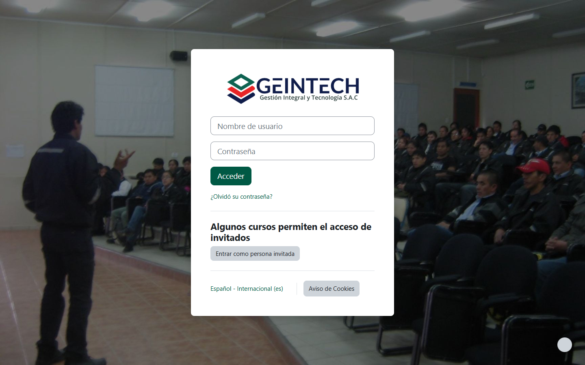
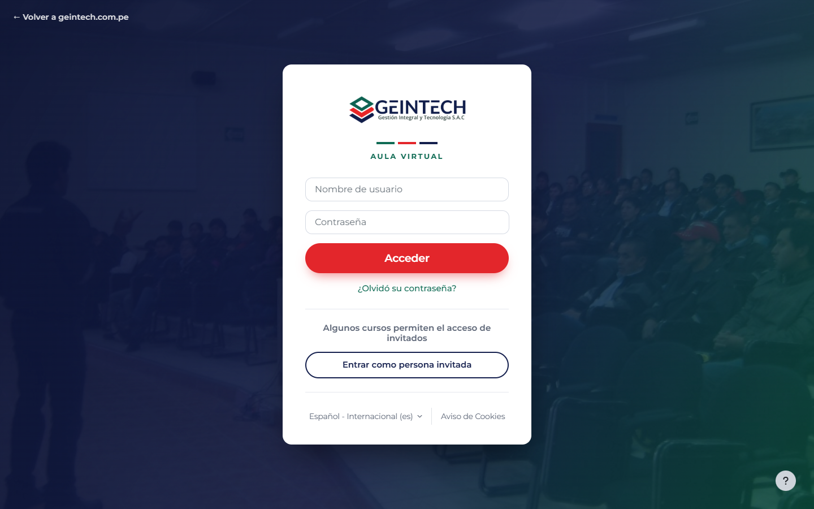

# Login del Aula Virtual (Moodle)

Personalización visual de la página de acceso del Moodle de GEINTECH
(`https://geintech.com.pe/aulavirtual/login/index.php`, Moodle 4.5, tema **Boost**).

No modifica archivos del servidor ni instala plugins: todo se pega desde el panel de administración
y se puede deshacer en cualquier momento.

| Antes | Después |
| --- | --- |
|  |  |

## Ver el login sin tocar Moodle

El botón "Aula Virtual" de la web lleva al Moodle real, que no cambia hasta que alguien pegue los estilos
en su panel. Para ver y ajustar el diseño antes, usa la vista previa local:

1. En una terminal del proyecto: `npm run moodle:preview` (compila `login.scss` y se queda vigilando cambios).
2. Abre `moodle/preview/index.html` con doble clic, o en VS Code con clic derecho → *Open with Live Server*
   (recarga sola). Si lo abres con doble clic, refresca el navegador (F5) después de cada cambio.

Es una réplica del login real (necesita internet para cargar los estilos base de Moodle). Los archivos de
`moodle/preview/` son solo para previsualizar y **no se suben a Moodle**.

## Archivos

| Archivo | Dónde va en Moodle |
| --- | --- |
| `login.scss` | Administración del sitio → Apariencia → Temas → **Boost** → pestaña **Avanzado** → **SCSS en bruto** |
| `additional-html-head.html` | Administración del sitio → Apariencia → **HTML adicional** → **Dentro de HEAD** |
| `additional-html-body.html` | Administración del sitio → Apariencia → **HTML adicional** → **Al abrir BODY** |

## Pasos

1. **Respaldo:** copia lo que haya hoy en "SCSS en bruto" y en "HTML adicional" (si hay algo) y guárdalo.
2. Pega el contenido de `login.scss` al **final** de "SCSS en bruto" y guarda.
3. Pega `additional-html-head.html` en "Dentro de HEAD" y `additional-html-body.html` en "Al abrir BODY". Guarda.
4. Administración del sitio → Desarrollo → **Purgar todas las cachés**.
5. Abre el login en una ventana de incógnito para verificar.

La imagen de fondo **no cambia**: se sigue usando la que ya está cargada en
Boost → General → *Imagen de fondo de la página de inicio de sesión*. Encima se aplica una capa con los
colores de la marca.

## Qué cambia

- Capa azul/verde de marca sobre la foto de fondo y tarjeta con sombra y animación de entrada.
- Franjas verde · rojo · azul y etiqueta "Aula Virtual" bajo el logo (igual que en la web).
- Tipografía Montserrat, campos redondeados, botón **Acceder** rojo a todo el ancho.
- Botón **Entrar como persona invitada** con estilo de contorno.
- Enlace "← Volver a geintech.com.pe" arriba a la izquierda.
- Ajustes para móvil (botón de mostrar contraseña y pie de página oscuro).

Los estilos están limitados a la página de login (`body#page-login-index`), así que no afectan los cursos
ni el resto de Moodle. Para deshacer, borra lo pegado y purga las cachés.

## Recomendación adicional

La zona horaria del sitio está en **Europa/Londres**. Cámbiala en
Administración del sitio → Ubicación → Configuración de ubicación → **Zona horaria por defecto** →
*America/Lima*, para que las fechas de cursos y entregas se muestren correctamente.
